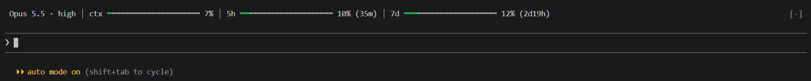

# usage-band

[中文](#中文) · [English](#english)



---

## 中文

一個 Claude Code mod：在終端機的輸入框正上方常駐一行，隨時顯示

- **目前的 model 與 effort**（預設介面要下指令才看得到）
- **context 用量**：避免對話不知不覺越拉越長
- **5 小時與每週額度用量**，以及距離重置的時間

```
 Opus 5.5 · high │ ctx ▬▬▬▬▬▬▬▬ 31% │ 5h ▬▬▬▬▬▬▬▬ 42% (1h23m) │ 7d ▬▬▬▬▬▬▬▬ 18% (3d4h)
```

### 顏色

進度條已使用的部分平時是綠色，超過門檻轉黃、轉紅（百分比數字同步變色）；未使用的部分是灰色。

| | 黃 | 紅 |
|---|---|---|
| ctx | > 40% | > 65% |
| 5h / 7d | > 60% | > 80% |

### 其他行為

- 進度條長度跟著視窗寬度伸縮，整行約佔 70%；視窗太窄時依序省略倒數、縮短進度條，百分比一定保留，不會換行。
- 剛開 session、還沒送出第一個問題前，讀數顯示 `—`。
- 只顯示主對話的 model / effort，subagent 的請求不影響。
- 不呼叫任何 API、不耗額度：數字來自 Claude Code 每輪對話後自己推送的讀數。
- 適用跑 Claude Code CLI 的終端機；已在 Windows 的 VS Code 內建終端機測試，PowerShell、cmd、Git Bash 走同一套介面（macOS / Linux 尚未實測）。
- 提示列可用 `ctrl+x ctrl+a` 或點 `[-]` 收合。

### 需求

- Claude Code **2.1.302** 以上（mod 功能目前為 early access，API 可能隨版本變動）
- 5h / 7d 額度只有 Claude 訂閱帳號（Pro / Max）才有資料；API key 帳號會一直顯示 `—`

### 安裝

在 Claude Code 終端機的輸入框輸入：

```
/plugin install usage-band --marketplace refinism-B/claude-usage-band
```

出現 `Add marketplace?` 時按 `y`，選擇安裝範圍時直接按 Enter（user，所有專案都生效）。看到 `Installed usage-band. Plugin is now active.` 即完成，立刻生效，不需重開。

或在 shell 執行：

```
claude plugin install usage-band --marketplace refinism-B/claude-usage-band
```

### 更新 / 移除

```
claude plugin update usage-band
claude plugin uninstall usage-band
```

---

## English

A Claude Code mod that keeps one line right above the prompt in your terminal, showing at a glance:

- **the current model and effort** (normally hidden behind a command)
- **context usage**, so a conversation doesn't quietly grow too long
- **5-hour and weekly quota usage**, with time left until each resets

```
 Opus 5.5 · high │ ctx ▬▬▬▬▬▬▬▬ 31% │ 5h ▬▬▬▬▬▬▬▬ 42% (1h23m) │ 7d ▬▬▬▬▬▬▬▬ 18% (3d4h)
```

### Colors

The used part of each bar is green, turning yellow then red past a threshold (the percentage turns with it); the unused part is gray.

| | Yellow | Red |
|---|---|---|
| ctx | > 40% | > 65% |
| 5h / 7d | > 60% | > 80% |

### Behavior

- Bars stretch with the window so the line fills about 70% of it; when the window is narrow it drops the countdowns, then shortens the bars. Percentages always stay, and the line never wraps.
- Before the first prompt of a session, readings show `—`.
- Only the main conversation's model and effort are shown; subagent requests don't change them.
- Makes no API calls and spends no quota: the numbers come from readings Claude Code pushes after each turn.
- Meant for any terminal running the Claude Code CLI; tested in VS Code's integrated terminal on Windows. PowerShell, cmd and Git Bash draw through the same interface (macOS / Linux not yet tested).
- Collapse the band with `ctrl+x ctrl+a` or by clicking `[-]`.

### Requirements

- Claude Code **2.1.302** or later (mods are early access; the API may change between releases)
- 5h / 7d quotas only have readings on a Claude subscription (Pro / Max); with an API key they stay `—`

### Install

At the prompt of a Claude Code terminal session:

```
/plugin install usage-band --marketplace refinism-B/claude-usage-band
```

Answer `y` to `Add marketplace?`, then press Enter to pick the user scope (all projects). `Installed usage-band. Plugin is now active.` means it's running already — no restart needed.

Or from a shell:

```
claude plugin install usage-band --marketplace refinism-B/claude-usage-band
```

### Update / remove

```
claude plugin update usage-band
claude plugin uninstall usage-band
```

---

[MIT](LICENSE) © refinism-B
